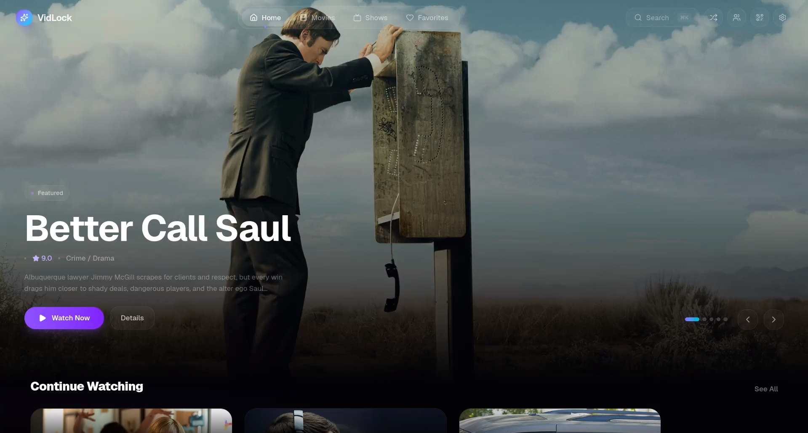
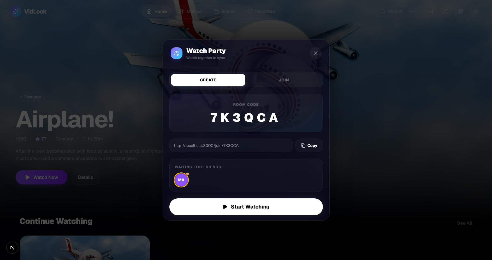
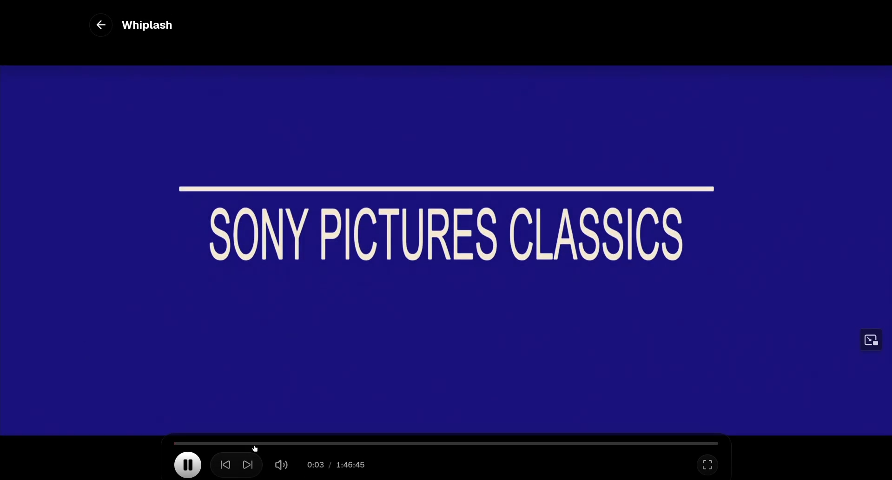
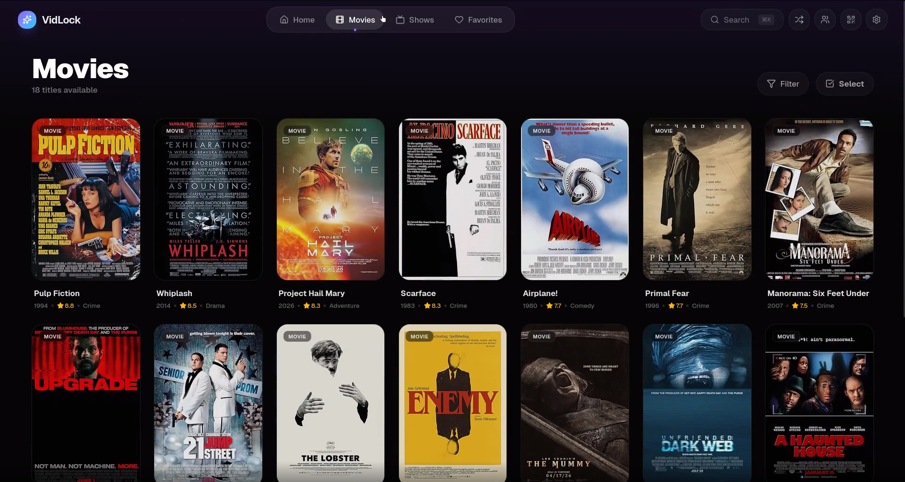

<p align="center">
  
</p>

<h1 align="center">VidLock</h1>

<p align="center">
  <em>Watch parties for your own library. No cloud. No accounts. No subscriptions.</em>
</p>

<p align="center">
  
  
  
  
  
  
  
</p>

<p align="center">
  <strong>Synced watch parties &middot; Voice chat &middot; Hardware transcoding &middot; Smart TV app</strong><br>
  <sub>
    A self-hosted, cinematic media server for the movies and shows you already own.
    One Node.js process. No external database, Redis, auth provider, or cloud storage.
  </sub>
</p>

<p align="center">
  <a href="#-why-vidlock">Why VidLock?</a> &middot;
  <a href="#-features">Features</a> &middot;
  <a href="#-quick-start">Quick Start</a> &middot;
  <a href="#-watch-party">Watch Party</a> &middot;
  <a href="#-limitations">Limitations</a> &middot;
  <a href="#-tech-stack">Tech Stack</a>
</p>

<p align="center">
  
</p>

https://github.com/user-attachments/assets/c1466194-9340-40f9-a5b9-6f6949c12d7d

---

## ✨ Why VidLock?

Most self-hosted media servers are built around managing a library. VidLock is built around **watching it together**: create a room, share a code or QR link, and everyone's player stays in sync, with built-in voice chat, no extra apps needed.

It also does the basics well. Point it at your folders, scan, and it will:

* Recursively discover video files, including on external drives
* Parse movie, show, season, and episode info from messy filenames
* Fetch metadata from OMDb, with optional backdrops from Fanart.tv
* Download posters and backdrops locally, so the library works offline
* Direct-play browser-friendly files, and transcode everything else with FFmpeg
* Remember watch progress and favorites

Your media files stay where they are. Metadata lives in a local SQLite database.

> Internet access is only needed when VidLock fetches metadata or artwork. Everything else runs locally.

---

## 🚀 Features

<table>
  <tr>
    <td width="50%">
      <h3>🎉 Watch Parties</h3>
      <p>
        Create a room, share a 6-character code or QR link, and watch in sync.
        Play, pause, and seek are scheduled against a shared server clock, with drift
        correction and a ready-check after every seek.
      </p>
      <p>
        Late guests knock to join and the host approves them. Built-in chat and
        WebRTC voice chat are included.
      </p>
    </td>
    <td width="50%">
      
    </td>
  </tr>

  <tr>
    <td width="50%">
      
    </td>
    <td width="50%">
      <h3>▶️ Cinematic Player</h3>
      <p>
        A custom HTML5 and HLS.js player with direct streaming, on-the-fly transcoding,
        hover frame previews on the scrub bar, subtitle and audio-track menus,
        keyboard shortcuts, and automatic resume.
      </p>
    </td>
  </tr>

  <tr>
    <td width="50%">
      <h3>📚 Smart Local Library</h3>
      <p>
        VidLock scans your folders, parses real-world filenames, and builds structured
        movie and TV metadata. Known files are reused on later scans to avoid
        unnecessary lookups.
      </p>
      <p>
        Anything it can't match confidently lands in an admin queue where you can fix it manually.
      </p>
    </td>
    <td width="50%">
      
    </td>
  </tr>
</table>

### 💎 More Highlights

* **Hardware transcoding.** FFmpeg encoders are probed at startup and the first working one is used:
  `NVENC → AMD AMF → VAAPI → Intel QSV → CPU (libx264)`
* **Smart direct play.** Browser-friendly files stream over HTTP Range requests with no transcoding.
* **HLS on demand.** MKV, AVI, WMV, and alternate audio tracks are transcoded into 3-second HLS segments.
* **10-bit HEVC support.** 10-bit sources are detected and converted to 8-bit for playback, on the GPU when the pipeline supports it.
* **Surround audio downmix.** AC3, E-AC3, DTS, and TrueHD are converted to stereo AAC.
* **Multiple audio tracks and subtitles.** External `.srt` / `.vtt`, embedded streams, and optional in-player search through OpenSubtitles (needs your own API key).
* **Continue Watching and favorites.** Progress is saved every few seconds, and titles are marked watched at 90%.
* **Group as Series.** Drag and drop loose files into seasons and episodes of a custom show.
* **Offline drive handling.** Unplug an external drive and its titles are marked offline instead of deleted.
* **Smart TV mode.** A D-pad-friendly `/tv` interface, plus a packaged LG webOS app (see [TV / webOS](#-tv--webos)).
* **Desktop app.** An Electron build with a system tray and auto-update is available from the Releases page.
* **Admin PIN.** Optionally protect the settings page and editing actions.
* **QR sharing.** Open VidLock from a phone by scanning a code that points to your LAN address.

---

## ⌨️ Player Shortcuts

| Key | Action |
| --- | --- |
| `Space` / `K` | Play / pause |
| `←` / `→` | Back / forward 10 seconds |
| `↑` / `↓` | Volume up / down |
| `M` | Mute |
| `F` | Fullscreen |
| `C` | Toggle subtitles |
| `V` | Mute / unmute voice chat (watch party) |
| `Ctrl/Cmd + K` | Search the library |

Double-click the left or right half of the video to skip 10 seconds.

---

## 🎉 Watch Party

```text
Host creates a room
        │
        ▼
6-character code + QR link
        │
        ▼
Guests open /join/<roomCode>
        │
        ▼
Host starts the party → everyone opens /watch/<roomCode>
        │
        ▼
Play / pause / seek stay synchronized
```

### How sync works

* On connect, each client runs several ping/pong rounds to estimate its clock offset from the server.
* Play and pause commands carry a server timestamp scheduled about 300 ms ahead, so every client acts at the same moment.
* The server sends a sync heartbeat every 10 seconds. Drift under 2 s is ignored, 2 to 15 s is corrected with a hard snap, and more than 15 s triggers a full re-seek.
* **Seek ready-check:** after the host seeks, playback pauses, guests buffer the new position and report ready, and playback resumes when everyone is ready (or after a 15 s timeout, so one slow client can't block the room).

### Joining and voice

* If the party has already started, new guests **knock** and the host approves or declines. Requests expire after 30 seconds.
* Voice chat uses peer-to-peer WebRTC with speaking indicators. It is a mesh, so it works best for small groups (around 4 to 6 people).
* Voice uses STUN/TURN relay servers to connect, so parties are not limited to one Wi-Fi network if the host is reachable.

### Party features

6-character room codes · QR joining · host-controlled playback · clock-offset estimation · heartbeat · seek ready-check · knock-to-join · host transfer on disconnect · member list · chat · voice chat · reconnection

---

## ⚡ Quick Start

### Requirements

* **Node.js 20+**
* **FFmpeg** and **ffprobe**
* Platform build tools if `better-sqlite3` needs to compile
* An **OMDb API key** (free)
* Optional: a **Fanart.tv API key**

### 1. Clone

```bash
git clone https://github.com/Manish6523/local-media-server.git
cd local-media-server
```

### 2. Install

```bash
npm install
```

On Debian / Ubuntu, if the native module fails to build:

```bash
sudo apt install build-essential python3
```

### 3. Configure

Create `.env.local`:

```dotenv
OMDB_API_KEY=your_omdb_key_here
FANART_TV_API_KEY=your_fanart_key_here

LOCAL_MEDIA_PATH=/path/to/your/media/
HDD_PATH=/path/to/optional/external/drive/
```

`FANART_TV_API_KEY` and `HDD_PATH` are optional. Folders and API keys can also be set later in **Settings**.

### 4. Run

```bash
# development
npm run dev

# production
npm run build
npm start
```

Open **http://localhost:2886**.

> Always use `npm start` in production. It launches VidLock's custom server (needed for Watch Party and artwork serving). Bare `next start` won't work.

---

## ⚙️ First Run

1. Open VidLock and go to **Settings**.
2. Add your media folder, and optionally an external drive.
3. Click **Scan now**.
4. Return to the home page to see your library.

---

## 📝 Filename Support

VidLock's parser is built for real-world libraries:

```text
Breaking.Bad.S01E01.mkv
The.Boys.S05E03.mkv
Attack.on.Titan.S04E10.mp4
Show.S02E03-05.mkv
Show.S03.E04.mkv
Show.S01-E05.mkv
E01.mkv
```

Resolution, codec, source, and release-group tags are stripped. Files without an episode pattern are treated as movies.

---

## 🎬 Streaming Architecture

```text
Media file
    │
    ├── Browser-compatible ──▶ HTTP Range stream (direct play)
    │
    └── Needs conversion ────▶ FFmpeg ──▶ HLS (3 s segments)
```

FFprobe inspects duration, codecs, audio and subtitle streams, and 10-bit HEVC. Transcodes are keyed by media, audio track, and start position, and idle transcodes are cleaned up automatically.

---

## 📺 TV / webOS

* **Browser mode:** LG webOS and NetCast browsers visiting `/` are redirected to `/tv`, a lightweight grid designed for remote-control navigation (arrows, Enter, Back).
* **Packaged app:** a webOS app (`com.manish6523.vidlock`) lives in `application/webos-app/`.
* The TV player is intentionally simple. It does not have the full subtitle and audio menus of the desktop player yet.

---

## 💾 Local-First Storage

No PostgreSQL, MongoDB, Redis, or Firebase. Persistence is SQLite via `better-sqlite3` and Drizzle ORM in WAL mode, storing media, shows, episodes, progress, favorites, and config. Artwork is cached on disk, and temporary HLS files live in your OS temp directory.

---

## 🛠️ Tech Stack

**Frontend:** Next.js 16, React 19, TypeScript, Tailwind CSS 4, Framer Motion, shadcn/ui, HLS.js
**Backend:** Custom Node.js server, Next.js App Router, Socket.IO, FFmpeg, ffprobe
**Database:** SQLite, better-sqlite3, Drizzle ORM
**Metadata:** OMDb, Fanart.tv, TVMaze
**Desktop:** Electron, electron-builder, electron-updater

---

## 🐛 Troubleshooting

| Issue | Solution |
| --- | --- |
| `better-sqlite3` fails to install | Install native build tools. On Debian/Ubuntu: `sudo apt install build-essential python3`. |
| Scan finds 0 files | Check the media path and make sure files use supported extensions (`.mp4`, `.mkv`, `.avi`, `.mov`, `.m4v`, `.wmv`). |
| Posters missing in production | Use `npm start`, not bare `next start`. |
| MKV playback is slow | Check the startup log for GPU detection. VidLock may have fallen back to CPU transcoding. |
| Watch Party drifts | Refresh the affected guest so its clock offset is recalculated. |
| Drive media shows as offline | Reconnect the drive and scan again. |
| Subtitle search fails | Add your own OpenSubtitles API key in Settings. |
| Forgot Admin PIN | Remove `admin_pin_hash` and `admin_pin_enabled` from the SQLite `config` table. |

---

## 🧭 Limitations

Honest notes on what VidLock doesn't do (yet):

* **Single-user state.** Watch progress and favorites are shared by everyone using the server. There are no user profiles.
* **One quality level.** Transcodes match the source resolution. There is no bitrate ladder for slow connections.
* **Voice chat is a mesh**, so it degrades beyond roughly 4 to 6 people.
* **Hardware encoders** (NVENC, AMF, VAAPI, QSV) are auto-detected, but not every combination has been tested on every GPU. If one misbehaves, please open an issue with your GPU and the startup log.
* **TV player** is basic compared to the desktop player.

---

## 📖 Documentation

Detailed codebase documentation (API routes, Socket.IO events, database schema, player pipeline, extension points) is in [DOCUMENTATION.md](./DOCUMENTATION.md).

---

## ⚠️ Network Security

VidLock is designed for a **trusted local network**.

It has no per-user authentication. The Admin PIN protects the settings UI, but media streaming and Watch Party endpoints are open by design so TVs and guests can connect easily, and some administrative API routes are not protected server-side by the PIN.

Do **not** expose VidLock to the public internet without putting an authentication layer in front of it, such as Cloudflare Access, a VPN like Tailscale, or a reverse proxy with login.

Only use VidLock with media you have the right to watch.

---

## 🤝 Contributing

Bug reports, feature ideas, and pull requests are welcome. If you change filename parsing, FFmpeg transcoding, GPU detection, Watch Party sync, or TV compatibility, please test the affected workflow first.

---

## 📄 License

VidLock is licensed under the **MIT License**.

---

<div align="center">

### Your media. Your hardware. Your watch party.

**No cloud. No accounts. No subscriptions.**

Built with ❤️ for local media collectors.

</div>