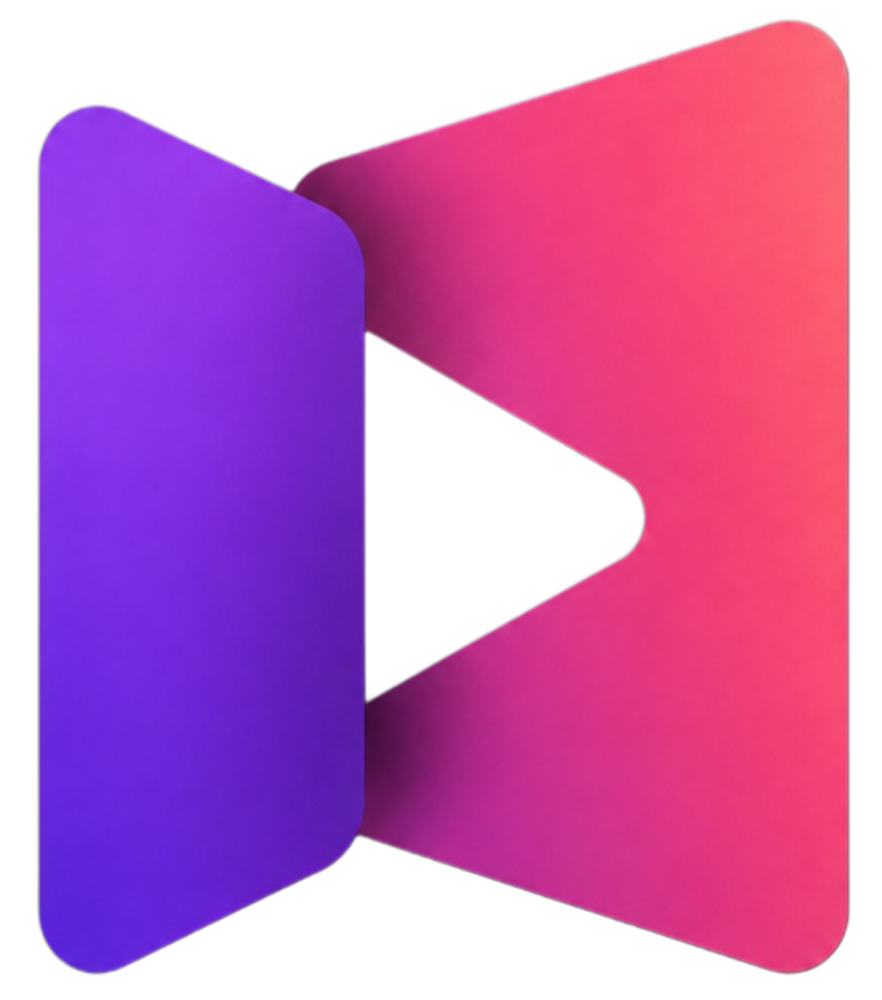
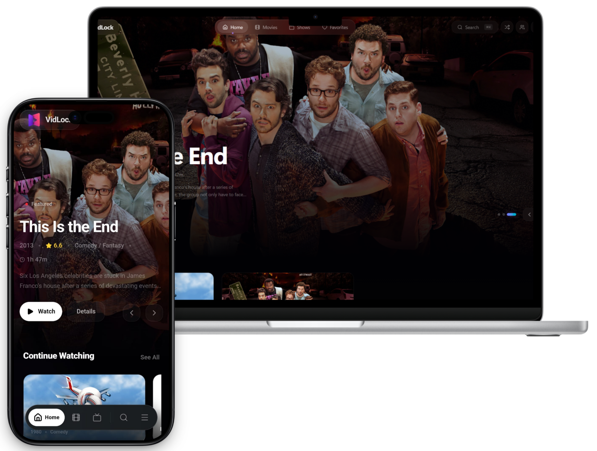
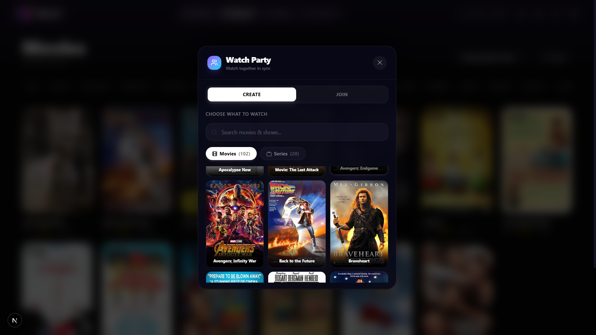
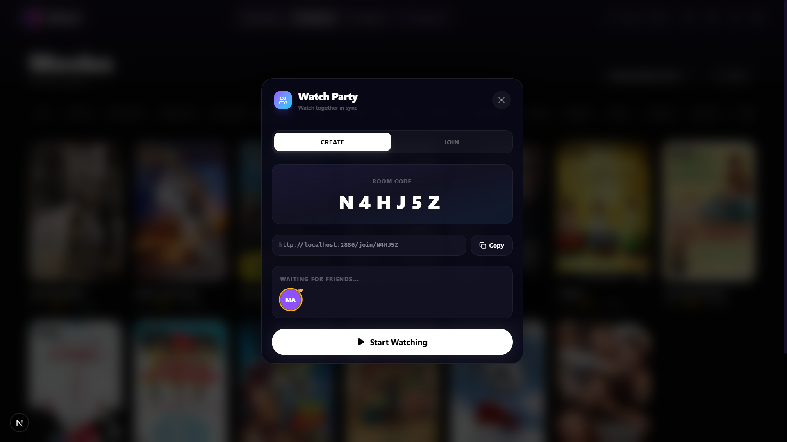
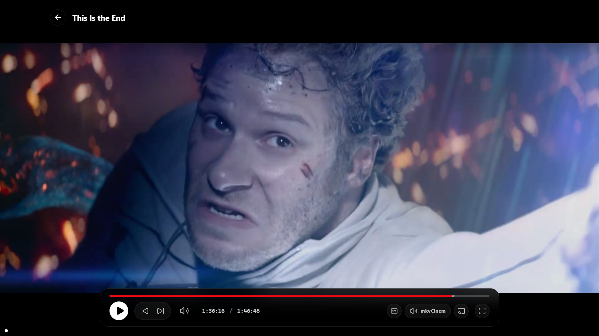
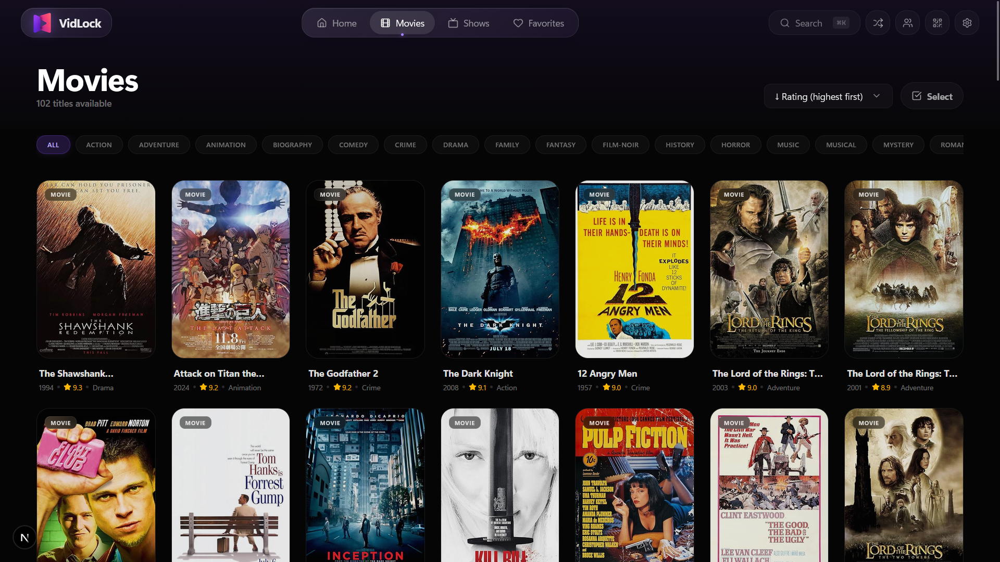
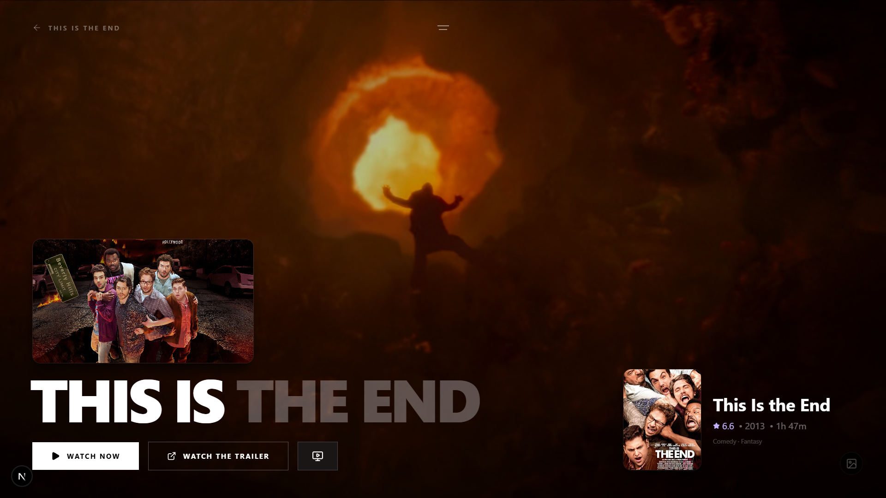
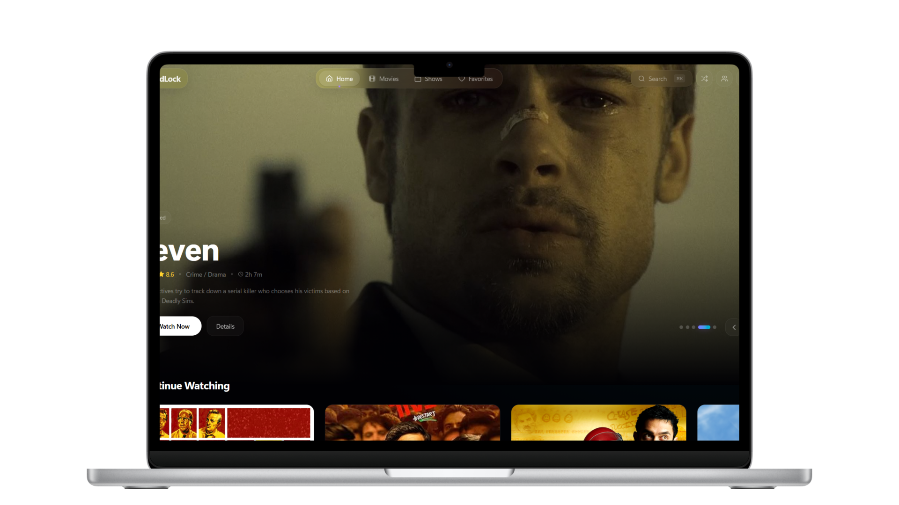
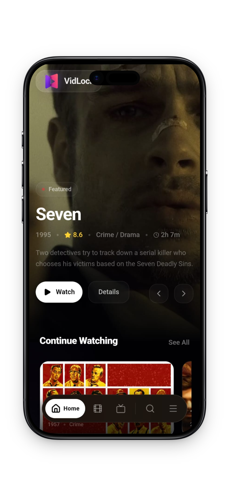

<p align="center">
  
</p>

<h1 align="center">VidLock</h1>

<p align="center">
  <em>Your movies. Your friends. In sync.</em>
</p>

<p align="center">
  
  
  <a href="https://github.com/Manish6523/local-media-server/releases/latest"></a>
</p>

<p align="center">
  <strong>Synced watch parties &middot; Voice chat &middot; Hardware transcoding &middot; Smart TV app</strong><br>
  <sub>
    Turn the movies and shows on your computer into a shared movie night.
    Create a room, invite your friends, and watch together from your own server.
  </sub>
</p>

<p align="center">
  <a href="#get-started">Download</a> &middot;
  <a href="#demo">Watch the demo</a> &middot;
  <a href="#features">Features</a> &middot;
  <a href="#screenshots">Screenshots</a> &middot;
  <a href="#watch-party">Watch Party</a> &middot;
  <a href="#run-from-source">Run from source</a> &middot;
  <a href="https://github.com/Manish6523/local-media-server/issues">Feedback</a>
</p>

<p align="center">
  <a href="assets/web/devices/mix01.png">
    
  </a>
</p>

<p align="center">
  <sub>One local library, ready for your laptop and phone.</sub>
</p>

<a id="demo"></a>

### See VidLock in action

https://github.com/user-attachments/assets/c1466194-9340-40f9-a5b9-6f6949c12d7d

**Keep your files where they are.** VidLock serves your local library to connected devices; guests do not need to create a VidLock account.

<a id="get-started"></a>

## Get started

**[Download the latest desktop release →](https://github.com/Manish6523/local-media-server/releases/latest)**

Choose the installer for your operating system from the release assets. Prefer running it yourself? Jump to [Run from source](#run-from-source).

| Platform | Package available in release v0.2.0 |
| --- | --- |
| [Windows](https://github.com/Manish6523/local-media-server/releases/latest) | `.exe` installer |
| [Linux](https://github.com/Manish6523/local-media-server/releases/latest) | x86_64 `.AppImage` or amd64 `.deb` |
| [macOS](https://github.com/Manish6523/local-media-server/releases/latest) | Apple Silicon / arm64 `.dmg` |

Check the release assets for the version and architecture you need. The releases page also contains update metadata; use an application package rather than a `.yml` or `.blockmap` file.

1. Launch VidLock on the computer that holds your media.
2. Open **Settings**, add a media folder, and enter your **OMDb API key** for metadata matching.
3. Click **Scan now**, then choose a movie or episode from your library.
4. Start a watch party and share its room link or QR code with another device.

Keep the server computer running while you watch. Other devices must be able to reach it over your network; a room code alone does not create a connection across the internet.

> **Current scope:** personal use on a trusted network. The optional Admin PIN is not complete API access control. Read [Network security](#network-security) before connecting other users or setting up remote access.

---

## ✨ Why VidLock?

VidLock is built around **watching your own library together**: create a room, share a code or QR link, and keep everyone's playback synchronized. Text chat and browser voice chat keep the conversation alongside the movie.

Use it for a movie night across laptops and phones, browsing a collection stored on an external drive, or watching on an LG TV. One computer serves the media; the other devices connect to it.

It also does the basics well. Point it at your folders, scan, and it will:

* Recursively discover video files, including on external drives
* Parse movie, show, season, and episode info from messy filenames
* Fetch metadata from OMDb, with optional backdrops from Fanart.tv
* Download posters and backdrops locally, so the library works offline
* Direct-play supported files and convert other supported formats with FFmpeg
* Remember watch progress and favorites

Your media files stay where they are. Metadata lives in a local SQLite database.

> Local playback can work without internet after setup and metadata caching. Metadata, artwork, online discovery, subtitle downloads, and external STUN/TURN services need internet access when used. Voice chat availability also depends on browser permissions and connection setup.

---

<a id="features"></a>

## 🚀 Features

### 🎉 Pick a movie. Invite your friends. Press play.

Create a room, share a six-character code or QR link, and watch in sync. Host playback commands, drift correction, and buffering checks help everyone stay together. Late guests can request to join, with text chat and browser voice chat alongside the movie.

<table>
  <tr>
    <td width="50%" align="center" valign="top">
      <a href="assets/web/watchpartymovieselection.png">
        
      </a>
      <p><strong>1. Choose what to watch</strong><br>Pick a movie or episode from your library.</p>
    </td>
    <td width="50%" align="center" valign="top">
      <a href="assets/web/watchpartywaitingroom.png">
        
      </a>
      <p><strong>2. Bring everyone together</strong><br>Share the room link, then start watching.</p>
    </td>
  </tr>
</table>

<table>
  <tr>
    <td width="50%">
      <a href="assets/web/player.png">
        
      </a>
    </td>
    <td width="50%">
      <h3>▶️ Cinematic Player</h3>
      <p>
        A custom HTML5 and HLS.js player with direct streaming, on-the-fly transcoding,
        hover frame previews on the scrub bar, subtitle and audio-track menus,
        keyboard shortcuts, and automatic resume.
      </p>
    </td>
  </tr>

  <tr>
    <td width="50%">
      <h3>📚 Smart Local Library</h3>
      <p>
        VidLock scans your folders, parses real-world filenames, and builds structured
        movie and TV metadata. Known files are reused on later scans to avoid
        unnecessary lookups.
      </p>
      <p>
        Anything it can't match confidently lands in an admin queue where you can fix it manually.
      </p>
    </td>
    <td width="50%">
      <a href="assets/web/library.png">
        
      </a>
    </td>
  </tr>
</table>

<a id="screenshots"></a>

<details>
  <summary><strong>Explore more screenshots — movie details, desktop, and mobile</strong></summary>

  <h3>Every title gets its own screen</h3>
  <p>Artwork, ratings, runtime, and playback actions in one place.</p>
  <a href="assets/web/moviedetails.png">
    
  </a>

  <h3>Browse on your laptop or phone</h3>
  <table>
    <tr>
      <td width="72%" align="center" valign="middle">
        <a href="assets/web/devices/heroPC1.png">
          
        </a>
        <p><strong>Desktop</strong></p>
      </td>
      <td width="28%" align="center" valign="middle">
        <a href="assets/web/devices/heroMobile1.png">
          
        </a>
        <p><strong>Mobile</strong></p>
      </td>
    </tr>
  </table>
  <p>Click any screenshot to view the full-size image.</p>
</details>

### 💎 More Highlights

* **Hardware transcoding.** FFmpeg encoders are probed at startup and the first working one is used:
  `NVENC → AMD AMF → VAAPI → Intel QSV → CPU (libx264)`
* **Smart direct play.** Browser-friendly files stream over HTTP Range requests with no transcoding.
* **HLS on demand.** MKV, AVI, WMV, and alternate audio tracks are transcoded into 3-second HLS segments.
* **10-bit HEVC support.** 10-bit sources are detected and converted to 8-bit for playback, on the GPU when the pipeline supports it.
* **Surround audio downmix.** AC3, E-AC3, DTS, and TrueHD are converted to stereo AAC.
* **Multiple audio tracks and subtitles.** External `.srt` / `.vtt`, embedded streams, and optional in-player search through OpenSubtitles (needs your own API key).
* **Continue Watching and favorites.** Resume from stored progress, keep favorites, and mark titles watched at 90%. Progress and favorites are shared across viewers.
* **Group as Series.** Drag and drop loose files into seasons and episodes of a custom show.
* **Offline drive handling.** Unplug an external drive and its titles are marked offline instead of deleted.
* **Smart TV mode.** A D-pad-friendly `/tv` interface, plus a packaged LG webOS app (see [TV / webOS](#tv-webos)).
* **Desktop app.** An Electron build with a system tray and auto-update is available from the Releases page.
* **Admin PIN.** An optional settings UI gate, with session checks on the manual-matching API. It is not a server-wide authentication system.
* **QR sharing.** Open VidLock from a phone by scanning a code that points to your LAN address.

---

## ⌨️ Player Shortcuts

| Key | Action |
| --- | --- |
| `Space` / `K` | Play / pause |
| `←` / `→` | Back / forward 10 seconds |
| `↑` / `↓` | Volume up / down |
| `M` | Mute |
| `F` | Fullscreen |
| `C` | Toggle subtitles |
| `V` | Mute / unmute voice chat (watch party) |
| `Ctrl/Cmd + K` | Search the library |

Double-click the left or right half of the video to skip 10 seconds.

---

<a id="watch-party"></a>

## 🎉 Watch Party

1. The host selects a movie or episode and creates a room.
2. VidLock generates a six-character code and a shareable QR link.
3. Guests open the link at `/join/<roomCode>` on the reachable server.
4. The host starts the party; viewers enter `/watch/<roomCode>`.
5. Host playback commands synchronize play, pause, and seek across the room.

When opening VidLock from another device, use the server computer's LAN address, such as `http://192.168.1.100:2886`. Replace the example IP with your computer's address. `localhost` on a phone or TV points to that device, not your server.

### How sync works

* On connect, each client runs several ping/pong rounds to estimate its clock offset from the server.
* Play and pause commands carry a server timestamp scheduled about 300 ms ahead to help clients act together. Synchronization is approximate, not frame-accurate.
* The server sends a sync heartbeat every 10 seconds. Drift under 2 s is ignored, 2 to 15 s is corrected with a hard snap, and more than 15 s triggers a full re-seek.
* **Seek ready-check:** after the host seeks, playback pauses, guests buffer the new position and report ready, and playback resumes when everyone is ready (or after a 15 s timeout, so one slow client can't block the room).

### Joining and voice

* If the party has already started, new guests **knock** and the host approves or declines. Requests expire after 30 seconds.
* Voice chat uses peer-to-peer WebRTC with speaking indicators. It is a mesh, so it works best for small groups (around 4 to 6 people).
* Voice uses WebRTC with external STUN/TURN configuration. It requires microphone permission and a secure browser context, such as HTTPS or localhost. Plain HTTP over a LAN IP may not allow microphone access.
* TURN can relay voice; it does not make the media server reachable. Remote viewing needs a separately configured, protected connection to the server.

### Party features

6-character room codes · QR joining · host-controlled playback · clock-offset estimation · heartbeat · seek ready-check · knock-to-join · host transfer on disconnect · member list · chat · voice chat · reconnection

---

<a id="run-from-source"></a>

## ⚡ Run from source

### Requirements

* **Node.js 22** is used by the release workflow; use it for a consistent starting point
* **FFmpeg** and **ffprobe** (resolved from the static packages by default; optional `FFMPEG_PATH` and `FFPROBE_PATH` overrides)
* Platform build tools if `better-sqlite3` needs to compile
* An **OMDb API key** for automatic metadata matching
* Optional: a **Fanart.tv API key**

### 1. Clone

```bash
git clone https://github.com/Manish6523/local-media-server.git
cd local-media-server
```

### 2. Install

```bash
npm ci
```

On Debian / Ubuntu, if the native module fails to build:

```bash
sudo apt install build-essential python3
```

### 3. Configure

Create `.env.local`:

```dotenv
OMDB_API_KEY=your_omdb_key_here
FANART_TV_API_KEY=your_fanart_key_here

LOCAL_MEDIA_PATH=/path/to/your/media/
HDD_PATH=/path/to/optional/external/drive/
```

`FANART_TV_API_KEY` and `HDD_PATH` are optional. Folders and API keys can also be set later in **Settings**. Without an OMDb key, the app can start and discover files, but automatic metadata matching is unavailable. Keep your API keys private.

### 4. Run

```bash
# development
npm run dev

# production
npm run build
npm start
```

Open **http://localhost:2886**.

> Always use `npm start` in production. It launches VidLock's custom server (needed for Watch Party and artwork serving). Bare `next start` won't work.

---

## ⚙️ First Run

1. Open VidLock and go to **Settings**.
2. Add your media folder, and optionally an external drive.
3. Click **Scan now**.
4. Return to the home page to see your library.

---

## 📝 Filename Support

VidLock's parser is built for real-world libraries:

```text
Breaking.Bad.S01E01.mkv
The.Boys.S05E03.mkv
Attack.on.Titan.S04E10.mp4
Show.S02E03-05.mkv
Show.S03.E04.mkv
Show.S01-E05.mkv
E01.mkv
```

Resolution, codec, source, and release-group tags are stripped. Files without an episode pattern are treated as movies.

---

## 🎬 Streaming Architecture

| Playback path | How it works |
| --- | --- |
| Direct play | Serves the file over HTTP with byte-range support. Actual playback depends on the device's container and codec support. |
| HLS | FFmpeg generates a playlist and three-second segments for supported conversion paths and alternate audio tracks. |

FFprobe inspects duration, codecs, audio and subtitle streams, and 10-bit HEVC. Transcodes are keyed by media, audio track, and start position. Active transcodes have an idle cleanup routine; multiple start positions can still consume significant CPU, GPU, and temporary disk space.

---

<a id="tv-webos"></a>

## 📺 TV / webOS

* **Browser mode:** LG webOS and NetCast browsers visiting `/` are redirected to `/tv`, a lightweight grid designed for remote-control navigation (arrows, Enter, Back).
* **Packaged app:** a webOS app (`com.manish6523.vidlock`) lives in `application/webos-app/`.
* The `/tv` browser interface and the packaged webOS client are separate implementations. The packaged client includes audio selection, text subtitles, and watch-party controls; browser and TV decoding support varies.
* See the [LG webOS setup and compatibility guide](./application/README.md) for packaging, connection setup, remote controls, and testing limits. The app is not presented as an LG Content Store installation.

---

## 💾 Local-First Storage

No PostgreSQL, MongoDB, Redis, or Firebase. Persistence is SQLite via `better-sqlite3` and Drizzle ORM in WAL mode, storing media, shows, episodes, progress, favorites, and config. Artwork is cached on disk, and temporary HLS files live in your OS temp directory.

---

## 🛠️ Tech Stack

**Frontend:** Next.js 16, React 19, TypeScript, Tailwind CSS 4, Framer Motion, shadcn/ui, HLS.js
**Backend:** Custom Node.js server, Next.js App Router, Socket.IO, FFmpeg, ffprobe
**Database:** SQLite, better-sqlite3, Drizzle ORM
**Metadata:** OMDb, Fanart.tv, TVMaze
**Desktop:** Electron, electron-builder, electron-updater

---

## 🐛 Troubleshooting

| Issue | Solution |
| --- | --- |
| `better-sqlite3` fails to install | Install native build tools. On Debian/Ubuntu: `sudo apt install build-essential python3`. |
| Scan finds 0 files | Check the media path and make sure files use supported extensions (`.mp4`, `.mkv`, `.avi`, `.mov`, `.m4v`, `.wmv`). |
| Posters missing in production | Use `npm start`, not bare `next start`. |
| MKV playback is slow | Check the startup log for GPU detection. VidLock may have fallen back to CPU transcoding. |
| Watch Party drifts | Refresh the affected guest so its clock offset is recalculated. |
| Phone or TV cannot connect | Use the server computer's LAN IP rather than `localhost`. Check the firewall, port `2886`, and router client isolation. |
| Voice chat has no microphone access | Allow microphone permission and use HTTPS for access from other devices. Browser security rules may block microphones on plain LAN HTTP. |
| MP4 opens but will not play | The extension alone does not guarantee compatible audio/video codecs. Check the file's codecs and test a known H.264/AAC MP4. |
| Drive media shows as offline | Reconnect the drive and scan again. |
| Subtitle search fails | Add your own OpenSubtitles API key in Settings. |
| Forgot Admin PIN | Remove `admin_pin_hash` and `admin_pin_enabled` from the SQLite `config` table. |

---

<a id="limitations"></a>

## 🧭 Limitations

Honest notes on what VidLock doesn't do (yet):

* **Single-user state.** Watch progress and favorites are shared by everyone using the server. There are no user profiles.
* **One quality level.** Transcodes match the source resolution. There is no bitrate ladder for slow connections.
* **Voice chat is a mesh**, so it degrades beyond roughly 4 to 6 people.
* **Hardware encoders** (NVENC, AMF, VAAPI, QSV) are auto-detected, but not every combination has been tested on every GPU. If one misbehaves, please open an issue with your GPU and the startup log.
* **TV player** is basic compared to the desktop player.
* **Playback compatibility varies.** Container extensions do not guarantee codec support. Test your actual files on the devices you plan to use.
* **Resource use grows with transcoding.** Concurrent viewers and seeks can create multiple HLS encoders; there is no overall HLS encoder concurrency limit yet.
* **Watch-party rooms are temporary.** Room state lives in server memory and is lost when the server restarts.

---

## 📖 Documentation

Detailed codebase documentation (API routes, Socket.IO events, database schema, player pipeline, extension points) is in [DOCUMENTATION.md](./DOCUMENTATION.md).

---

<a id="network-security"></a>

## ⚠️ Network Security

VidLock is designed for a **trusted local network**.

It has no per-user authentication. The Admin PIN protects the settings UI, but media streaming and Watch Party endpoints are open by design so TVs and guests can connect easily, and some administrative API routes are not protected server-side by the PIN.

Do **not** port-forward VidLock directly to the public internet. API authorization and filesystem access controls need further hardening. The Admin PIN and room codes should not be treated as security boundaries.

For remote experiments, restrict access to trusted people through a private VPN or an authenticated gateway that covers both HTTP and Socket.IO. This limits access; it does not fix the application's authorization gaps. Keep the server's own port inaccessible from untrusted networks.

Only use VidLock with media you have the right to watch.

---

## 🤝 Contributing

Trying VidLock on your own setup is useful feedback. [Report a bug or suggest a feature](https://github.com/Manish6523/local-media-server/issues), and include:

* Your OS, VidLock version, and browser or TV model
* Steps to reproduce, expected behavior, and what happened
* For playback issues: container, video/audio codecs, GPU, and relevant logs

Remove API keys, private paths, and other sensitive details before sharing logs. For security issues, avoid posting exploit details publicly; contact the maintainer privately first.

Pull requests are welcome. If you change filename parsing, FFmpeg transcoding, GPU detection, Watch Party sync, or TV compatibility, test the affected workflow and describe what you checked.

If VidLock earns a place in your movie nights, a GitHub star or sharing your setup helps other people discover it.

### Meet the maker

Built by **[Manish Sharma](https://github.com/Manish6523)**. Find more of my work at **[manish.casa](https://www.manish.casa)**.

---

## 📄 License

VidLock is licensed under the **MIT License**.

---

<div align="center">

### Your media. Your hardware. Your watch party.

**Local media. No VidLock accounts. No subscriptions.**

Built with ❤️ for local media collectors.

</div>
