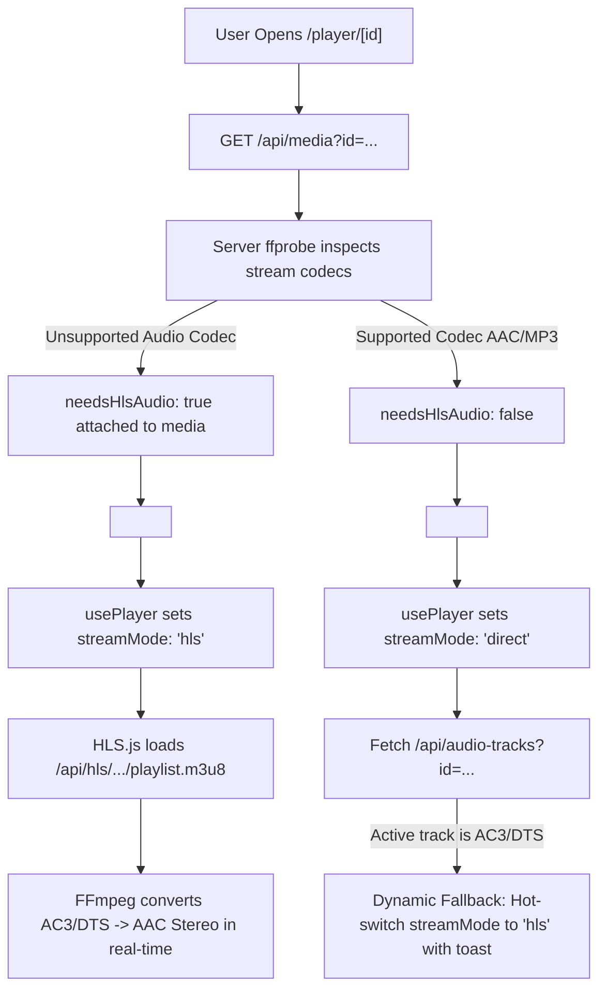

# Unsupported Audio Playback Auto-Fallback to HLS Transcode

## Overview & Background
In standard web browsers (Google Chrome, Microsoft Edge, Mozilla Firefox), HTML5 `<video>` only supports native playback of common stereo audio formats:
- **Supported:** AAC, MP3, Opus, FLAC, Vorbis, WAV.
- **Unsupported:** AC-3 (Dolby Digital), E-AC-3 (Dolby Digital Plus), DTS, DTS-HD, TrueHD, MLP, WMA.

When playing modern BluRay MKV rips (e.g. `Black.Swan.2010.1080p.BluRay.x265-YAWNTiC.mkv`), the video codec (`hevc` or `h264`) decodes successfully, but the browser drops the AC-3 5.1 surround audio track silently without throwing an HTML5 `<video>` error event. The user sees the movie playing smoothly, but with **zero sound**.

VidLock already has a built-in HLS transcode engine (`/api/hls/[mediaId]/[audioTrack]/[start]/[file]`) powered by FFmpeg with hardware acceleration (NVENC, AMF, VAAPI, QSV) that downmixes multi-channel audio to stereo AAC (`-c:a aac -b:a 192k -ac 2`).

This guide documents the full implementation to automatically detect unsupported audio codecs and initialize or switch playback to HLS.

---

## Architecture & Data Flow



---

## Step-by-Step Code Changes

### 1. `lib/db.ts`
Add optional codec metadata fields to the `MediaEntry` interface:

```diff
 export interface MediaEntry {
   id: number;
   filepath: string;
   filename: string;
   ...
   omdb_confirmed: number;
   exactDuration?: number;
+  audioCodec?: string;
+  videoCodec?: string;
+  needsHlsAudio?: boolean;
 }
```

---

### 2. `app/(main)/api/media/route.ts`
When returning single media details (`id` query param), run `ffprobe` to inspect stream codecs:

```ts
// Return single media entry
if (id) {
  const media = getMediaById(parseInt(id, 10));
  if (!media) {
    return NextResponse.json({ error: "Not found" }, { status: 404 });
  }

  let exactDuration = media.runtime ? media.runtime * 60 : 0;
  let audioCodec: string | undefined;
  let videoCodec: string | undefined;
  let needsHlsAudio = false;

  if (fs.existsSync(media.filepath)) {
    try {
      const output = execSync(
        `"${FFPROBE}" -v error -show_entries format=duration -show_entries stream=codec_name,codec_type -of json "${media.filepath}"`,
        { encoding: "utf-8", timeout: 8000 }
      );
      const parsed = JSON.parse(output);
      const dur = parseFloat(parsed.format?.duration);
      if (!isNaN(dur) && dur > 0) exactDuration = dur;

      const streams = parsed.streams || [];
      const audioStream = streams.find((s: any) => s.codec_type === "audio");
      const videoStream = streams.find((s: any) => s.codec_type === "video");

      if (audioStream?.codec_name) {
        audioCodec = audioStream.codec_name.toLowerCase();
        const UNSUPPORTED_AUDIO = ["ac3", "ac-3", "eac3", "ec-3", "dts", "dts-hd", "dca", "truehd", "mlp", "wma", "wmav2", "wmapro"];
        if (audioCodec && UNSUPPORTED_AUDIO.includes(audioCodec)) {
          needsHlsAudio = true;
        }
      }
      if (videoStream?.codec_name) {
        videoCodec = videoStream.codec_name.toLowerCase();
      }
    } catch (err) {
      console.error("[Media] ffprobe stream probe error:", err);
    }
  }

  const available = media.source === 'hdd' ? (hddConnected ? 1 : 0) : 1;
  return NextResponse.json({ ...media, exactDuration, audioCodec, videoCodec, needsHlsAudio, available });
}
```

---

### 3. `app/(main)/player/[id]/page.tsx`
Forward `baseNeedsTranscode` into `<MediaPlayer />`:

```diff
     <MediaPlayer
       mediaId={id}
       title={media.title}
       type={media.type}
       season={media.season}
       episodeStart={media.episode_start}
       episodeEnd={media.episode_end}
       filename={media.filename}
       exactDuration={media.exactDuration || 0}
       initialWatchProgress={media.watch_progress || 0}
+      baseNeedsTranscode={Boolean(media.needsHlsAudio)}
     />
```

---

### 4. `app/(main)/watch/[roomCode]/page.tsx`
Forward `baseNeedsTranscode` into `<MediaPlayer />` for watch parties:

```diff
         <MediaPlayer
           mediaId={String(media.id)}
           title={media.title}
           type={media.type}
           season={media.season}
           episodeStart={media.episode_start}
           episodeEnd={media.episode_end}
           filename={media.filename}
           exactDuration={media.exactDuration || 0}
           initialWatchProgress={0}
+          baseNeedsTranscode={Boolean(media.needsHlsAudio)}
           watchPartyMode={{
```

---

### 5. `components/Player/MediaPlayer.tsx`
Accept `baseNeedsTranscode` in `MediaPlayerProps` and forward it into `usePlayer`:

```diff
 interface MediaPlayerProps {
   mediaId: string;
   title: string;
   type: "movie" | "show";
   season?: number | null;
   episodeStart?: number | null;
   episodeEnd?: number | null;
   filename: string;
   exactDuration: number;
   initialWatchProgress?: number;
   watchPartyMode?: WatchPartyMode;
+  baseNeedsTranscode?: boolean;
 }

 export default function MediaPlayer({
   mediaId,
   title,
   type,
   season,
   episodeStart,
   episodeEnd,
   filename,
   exactDuration,
   initialWatchProgress = 0,
   watchPartyMode,
+  baseNeedsTranscode = false,
 }: MediaPlayerProps) {
   ...
   const {
     ...
   } = usePlayer(
     mediaId,
-    false,
+    baseNeedsTranscode,
     exactDuration,
     initialWatchProgress,
     watchPartyMode?.roomCode,
   );
```

---

### 6. `components/Player/usePlayer.ts`

#### A. Initial State Initialization
```ts
export const INCOMPATIBLE_BROWSER_AUDIO = new Set([
  "eac3", "ac3", "ac-3", "ec-3", "dts", "dts-hd", "dca", "truehd", "mlp", "wma", "wmav2", "wmapro"
]);

export function usePlayer(
  mediaId: string, 
  baseNeedsTranscode: boolean, 
  exactDuration: number, 
  initialWatchProgress: number = 0,
  roomCode?: string | null
) {
  ...
  const [transcodeStartTime, setTranscodeStartTime] = useState(baseNeedsTranscode ? Math.floor(initialWatchProgress) : 0);
  const [showResumeToast, setShowResumeToast] = useState(initialWatchProgress > 0);
  const [streamMode, setStreamMode] = useState<StreamMode>(baseNeedsTranscode ? "hls" : "direct");
  ...
  const pendingDirectSeekTimeRef = useRef<number | null>(
    !baseNeedsTranscode && initialWatchProgress > 0 ? initialWatchProgress : null
  );
```

#### B. Dynamic Track Inspector on `/api/audio-tracks` Fetch
```ts
  useEffect(() => {
    fetchSubtitles();

    fetch(`/api/audio-tracks?id=${mediaId}`)
      .then((r) => r.json())
      .then((data: AudioTrack[]) => {
        if (Array.isArray(data)) {
          setState((s) => ({ ...s, audioTracks: data }));

          // Auto-detect if current or primary audio track codec is unsupported in browser direct play
          const activeTrack = data.find((t) => t.index === state.activeAudioTrack) || data[0];
          const codec = activeTrack?.codec?.toLowerCase();
          if (codec && INCOMPATIBLE_BROWSER_AUDIO.has(codec)) {
            setStreamMode((currentMode) => {
              if (currentMode === "direct") {
                console.log(`[Player] Audio codec "${codec}" is unsupported for direct playback. Auto-switching to HLS transcode.`);
                showStreamToastMessage(`Audio codec (${codec.toUpperCase()}) requires transcode. Switched to HLS.`);
                const v = videoRef.current;
                const curPos = v && isFinite(v.currentTime) && v.currentTime > 0 ? v.currentTime : state.currentTime;
                setTranscodeStartTime(Math.floor(curPos));
                return "hls";
              }
              return currentMode;
            });
          }
        }
      })
      .catch(console.error);
  }, [mediaId, showStreamToastMessage, state.activeAudioTrack, state.currentTime]);
```

#### C. Audio Track Switching Handler
```ts
  const setActiveAudioTrack = useCallback((index: number) => {
    const v = videoRef.current;
    const currentTime = v?.currentTime || 0;
    const realTime = needsTranscode ? transcodeStartTime + currentTime : currentTime;

    const targetTrack = state.audioTracks.find((t) => t.index === index);
    const targetCodec = targetTrack?.codec?.toLowerCase();
    const isUnsupported = targetCodec && INCOMPATIBLE_BROWSER_AUDIO.has(targetCodec);

    if (streamMode === "direct" && (index > 0 || isUnsupported)) {
      showStreamToastMessage(
        isUnsupported 
          ? `Switched to HLS for ${targetCodec?.toUpperCase()} audio support` 
          : "Switched to HLS to support alternate audio track"
      );
      setTranscodeStartTime(Math.floor(realTime));
      setStreamMode("hls");
    }

    setState((s) => ({ ...s, activeAudioTrack: index }));
    ...
```

---

## Verification Test Case
- **Movie:** *Black Swan (2010)*
- **Path:** `D:\media\Black.Swan.2010.1080p.BluRay.x265-YAWNTiC.mkv`
- **Video:** HEVC 1080p
- **Audio:** AC-3 5.1 surround
- **Outcome:** Direct stream plays silently in Chromium, but starting with HLS mode or auto-switching transcode yields stereo AAC sound with AMD/Nvidia GPU hardware acceleration.
